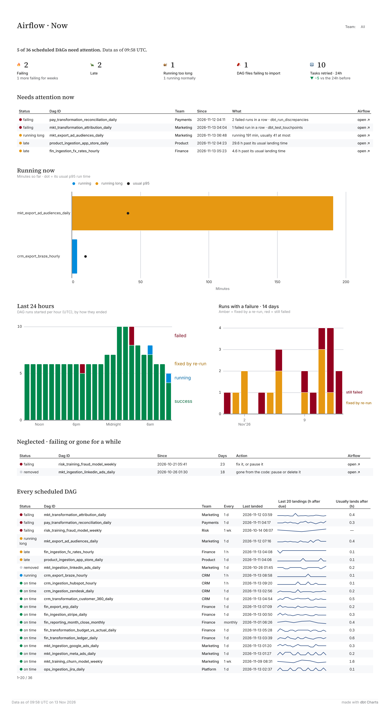

# Airflow 3 monitoring with DuckDB + dbt

A monitoring dashboard for Airflow 3, built only with **DuckDB + dbt** (and [dbt Charts](https://dbtcharts.com) to draw it).
No Grafana, no Prometheus, no server, no Airflow plugin: it reads Airflow's own metadata database.



```
Airflow 3 metadata DB ──DuckDB postgres extension──▶ DuckDB file ──dbt──▶ marts + tests ──dbt Charts──▶ 3 boards
   (Postgres, read-only)     incremental copy, on demand          all aggregation in DuckDB      YAML + SQL
```

## Try it: no Airflow needed

```bash
brew install uv
make install             # DuckDB 2.x (brew, if missing) + dbt Fusion >= 2.0.11 and dct (dbt Charts) as uv tools
make demo                # ~10 s, then http://localhost:8080/now/
```

`make demo` generates a made-up Airflow 3 metadata database ([`demo/fake_airflow.sql`](demo/fake_airflow.sql), plain
DuckDB SQL): the data team of an imaginary company, 39 DAGs, 45 days of runs ending now, flaky APIs, retries, runs
fixed by a clear, a model getting slower every day, and a bad morning: two DAGs failing, one stuck for 3 hours, one
stuck in the queue, a DAG file that no longer imports, one failing for weeks, one deleted but never paused.
Then it runs the same dbt models and boards as on a real Airflow. The screenshots come from it.

## Run it on your Airflow 3

```bash
cp .env.example .env     # your Airflow metadata DB host/db/user (read-only is enough), UI URL, team names
export PGPASSWORD=...    # or store it in macOS Keychain, see .env.example

make live                # load what's new (seconds after the first load), open http://localhost:8080/now/
```

Nothing refreshes on its own: `make refresh` loads what's new, then reload the page. The Now board says how old its
data is. `make serve` / `make stop` start and stop the dashboards.

## Boards

| Board | What it answers |
|---|---|
| [now](docs/screenshots/now.png) | Is anything wrong right now? Failing, late, running too long, broken DAG files, retries; since when, which task, a link into Airflow. The last 24 h by the hour, failures over 14 days, the DAGs left failing for weeks, every DAG's landing times |
| [reliability](docs/screenshots/reliability.png) | Over a period: least reliable DAGs, flakiest tasks and the worker hours their retries cost, when daily DAGs land, compute hours by team and DAG, when the workers are busiest |
| [dag](docs/screenshots/dag.png) | One DAG: daily median/p95 duration, Airflow-style grid colored by task state, latest failures and retries with log links, Gantt of the latest run, slowest tasks |

Statuses (`dag_health`), first match wins:

| Status | When |
|---|---|
| removed | its file is gone from the DAG bundle (`dag.is_stale`), but it was never paused |
| failing | its latest finished scheduled run failed |
| running long | a run is going for over 2× its usual p95, and 15 min more than it |
| late | the next run should have landed by now: last delivered interval + schedule interval + its p90 landing time + 15 min |
| running / on time | |

A problem **needs attention now** when it started recently; failing or late for over max(7 days, 2 schedule intervals)
moves it to **neglected**, so old news doesn't bury new problems.

## The whole pipeline

| Model | What |
|---|---|
| `stg_airflow__dags` | current DAGs: paused, stale (file gone), import errors |
| `stg_airflow__dag_runs` | incremental copy of `dag_run` |
| `stg_airflow__task_attempts` | one row per try: `task_instance` ∪ `task_instance_history` (Airflow 3 gives each try its own id) |
| `stg_airflow__import_errors` | DAG files Airflow cannot parse right now |
| `dim_dags` | team (from the dag_id prefix) + real schedule interval |
| `fct_dag_runs` | run: duration, landing delay, `had_failure` (also counts runs fixed by a clear) |
| `fct_task_instances` | task: final state, tries, `is_flaky`, compute time of every try, time thrown away by retries |
| `dag_health` | status, since when, failed runs in a row, failed tasks, Airflow links, per scheduled DAG |
| `airflow_ui` | the Airflow UI base URL, so boards can link runs and task logs |

Teams come from the dag_id prefix: `AIRFLOW_DAG_TEAMS=fin:Finance,mkt:Marketing` in `.env` keeps your team names out
of the repo ([`seeds/dag_teams.csv`](seeds/dag_teams.csv) holds the demo's).

## Gotchas worth knowing

- **Push the incremental filter down**: compute `max(updated_at)` first and inline it as a literal
  ([`macros/incremental_since.sql`](macros/incremental_since.sql)). A `(select max(...) from {{ this }})` subquery is
  not sent to Postgres and scans the whole table (3 min vs a few seconds).
- **Cleared runs**: a clear resets `dag_run.start_date`, and a fixed run ends `success`: `state = 'failed'` misses it,
  the task tries don't.
- **Deleted DAGs**: Airflow 3 keeps them as `is_stale`; unless paused they look late forever.
- dbt writes the DuckDB file while dct serves it: a page loaded during `make refresh` (~7 s) may fail, reload it.
- Rows purged by `airflow db clean` stay in your local copy, so `make full-refresh` on a live instance loses them.
- Don't name the local file `airflow.duckdb`: its catalog would clash with the `airflow` attach alias.
